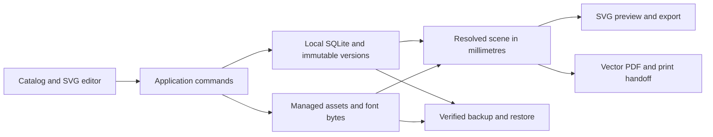

# WVM V1 Release Implementation Plan

> Execution update (2026-10-14): the user directed that implementation proceed solo without agents. The packaged catalog now includes a non-print-ready preview bound to each record's exact immutable template version; the full editor, rendering, PDF/print, import, and backup stages remain.

**Goal:** Complete the Windows-first Warehouse Visual Manager specified in `docs/V1_SPEC.md`, retaining local SQLite, versioned records, a millimetre editor, deterministic vector export, controlled printing, and safe backup/restore.

**Architecture:** React UI invokes application services and a narrow Tauri bridge. Rust owns local SQLite, assets, filesystem exports, backup/restore, and operating-system handoff. The editor and SVG/PDF exports consume the same canonical document and resolved scene; domain code remains independent of platform adapters.

**Tech stack:** Existing pinned React/TypeScript/Vite/Vitest, Tauri 2/Rust/rusqlite. Select a vector SVG-to-PDF library and bundled permissively licensed font after official-documentation research. Retain exact dependency pins and licence records.

**Spec:** `docs/V1_SPEC.md`, `docs/DATA_MODEL.md`, `docs/CANVAS_EDITOR.md`, `docs/RENDERING_PIPELINE.md`, existing ADRs and Tasks 4–10 in `docs/IMPLEMENTATION_PLAN.md`.

## Repository analysis

- Repository: `https://github.com/treborygan/WVM`; default branch `main`; inspected foundation commit `8ee366b`.
- The initial baseline observations below describe that foundation commit. The current local release branch has completed the migrated catalog, native SQLite commands, and lifecycle UI; current status is recorded after the global constraints.
- At the inspected foundation commit, `App.tsx` rendered only a foundation message and the Tauri shell had no registered application commands, packaging, or CSP.
- Open PR #8 (`codex/task-4-migration-catalog`, tip `67bf970`) adds catalog use cases and private staging/reconciliation/import code. Reuse its reviewed local changes after fresh tests; do not merge the GitHub PR without explicit authorization.
- Existing documentation describes a desktop product, not a hosted site. A browser preview can aid UI verification but must not replace SQLite persistence or packaged desktop acceptance.
- Fresh npm installation succeeded and reported one high-severity advisory. Identify the affected package and repair with the smallest compatible pinned update, then rerun gates.
- The private 145-record migration baseline and physical sign/printer acceptance require selected private source files and hardware. Synthetic tests cannot establish those results.

## Global constraints

- No operational records, private source paths, production databases, secrets, or private reports in Git or release samples. Keep DHL binaries out of Git; the user-requested branded MSI is a local private build whose source assets are hash-verified and staged in an ignored directory.
- Preserve ADR-001 local SQLite, ADR-002 shared SVG scene, ADR-003 immutable documents, and deferred SharePoint/MCP/AI scope.
- Store the active database under the platform-local application-data directory, never this checkout or a synced/shared folder.
- Do not add automatic GitHub Actions. Do not merge main or publish a GitHub release without explicit user approval.
- The user changed execution mode to solo; one implementer owns code, tests, review, packaging, and release evidence. Do not delegate further work.
- Preserve test-first implementation where practical, run the relevant full checks, inspect the diff, and commit each stable milestone. Source archives and operational inputs remain read-only/outside Git.

## Updated milestone status (2026-10-14)

- Stage 1: catalog migration and repository safety contracts are implemented locally on `codex/wvm-v1-release`; npm's reported high advisory was fixed by upgrading the locked `source-map-js` transitive dependency to 1.2.2.
- Stage 2: persistent Windows local-app-data SQLite catalog, five synthetic template families, create/edit/duplicate, immutable version history, filtering/search/sorting/paging, lifecycle operations, and special Gang publication gate are implemented. A follow-up rejects non-string legacy canonical values before publish/reactivate, preserving the original version and transaction state. Catalog detail returns the exact immutable template document linked to each current visual version.
- Stable usable milestone: the Tauri shell has a restrictive CSP and MSI/NSIS bundling. The local branded MSI verifies the supplied DHL logo, delivery illustration, and Desktop Delivery regular/bold fonts against the prepared manifest. The unsigned MSI was rebuilt and the packaged executable opened on Windows; full-width UI shows the DHL logo and persisted synthetic catalog.
- A catalog preview now renders escaped deterministic SVG for text, simple shapes, and lines. It is explicitly labeled preview-only and reports unavailable images and simplified wrapping/font-fit behavior. Newly initialized synthetic templates have visible example layouts; prior template versions remain unchanged and immutable.
- Still required for V1: full millimetre editor and undo/redo, shared production render scene and sheet composition, native vector PDF and print handoff, local asset/brand management, private 145-record reconciliation, verified backup/restore, six physical special-sign checks, and printer/media calibration.
- No branch merge, public GitHub release, or company asset publication has occurred.

## Review focus

1. Native IPC is an untrusted boundary: reject malformed documents, identifiers, lifecycle bypasses, path traversal, and corrupted backups before changing active data.
2. Published render reproducibility: later content/layout/brand changes must not change historical published SVG/PDF bytes; pin brand/font/asset snapshots.
3. Physical geometry: equivalent physical drag/resize at 25%, 100%, and 400% must have identical millimetre results; sheets must fit without overlap.
4. Restore interruption and export failure: preserve the prior catalog and return actionable errors; never report success after a partial write.
5. Missing assets/fonts, extreme text, and unresolved bindings: deterministic fallback or blocking diagnostic, consistent in preview and export.

## Stage 1: Recover catalog work and establish release baseline

**Files:** Existing PR #8 catalog/migration files; `package.json`, lockfile, dependency register; release ledger under `work/`.

**Interfaces:** Existing `listVisuals`, `getVisualDetail`, `duplicateVisual`, `reconcileMigration`, and importer interfaces remain canonical. Native catalog queries must project searchable fields rather than load all document JSON.

- [x] Run current frontend tests, typecheck/build, Rust tests/check/fmt and record the exact baseline.
- [x] Review PR #8 against current domain/SQLite contracts, especially required bindings, template family, normalized key collisions, six exception gates, and private report separation.
- [x] Apply PR #8 locally to an isolated release branch, address confirmed findings, and rerun catalog/import/reconciliation tests. Preserve all source identities/references and raw evidence.
- [x] Identify the npm advisory, apply the compatible pinned update, and rerun tests/build.
- [x] Commit and review this stage before dependent workflows.

## Stage 2: Wire persistent desktop catalog, authoring, and lifecycle

**Files:** `src-tauri/src/commands/`, `src-tauri/src/main.rs`, SQLite adapters/migrations; `src/application/`, `src/adapters/desktop/`; `src/features/catalog/`, application composition.

**Interfaces:** `CatalogGateway` exposes list/detail/create/duplicate/save-draft/transition/history operations with typed request/result DTOs. `SaveDraftRequest` includes visual identity, expected revision, values, and selected template/document. Lifecycle commands consume domain validation and atomically write version, pointer, and audit records.

- [x] Add Rust bridge/service tests for first-run local data path, persistence across reopen, invalid IPC payload, stale save, family mismatch, rollback, and rejected unvalidated special publication.
- [x] Implement application-data initialization, managed database state, parameterized catalog queries, and narrow registered commands. Keep SQL out of UI and validate again in the native authority.
- [x] Add UI tests for loading/empty/error, search/filter/sort, detail, create, duplicate, save, lifecycle, and immutable history.
- [x] Implement a catalog/detail shell with explicit synthetic sample initialization, five template families, validation state, and draft/review/published/retired indicators.
- [x] Verify catalog create/edit/restart and atomic audit updates. Published render immutability remains pending the renderer stage.

## Stage 3: Shared scene, physical editor, and deterministic SVG

**Files:** `src/rendering/`, `src/domain/editor-commands.ts`, `src/domain/editor-history.ts`, `src/features/editor/geometry/`, editor components and tests.

**Interfaces:** `buildRenderScene(input)` resolves exact immutable versions, brand snapshot, and asset hashes into geometry/content or diagnostics. `renderSceneToSvg(scene)` returns deterministic escaped SVG. `composeSheet(scene, printRules, outputSheet)` returns an output-sized sheet with exact slot translations. `TemplateDocument.page` is the finished single-copy artwork size; `PrintRequest.output_sheet` supplies physical paper geometry. Canonical production preserves scale 1.0, uses row-major centered equal slots, and blocks artwork exceeding a slot. Operator-selected scaling must be explicit and displayed. Define `repetition.grid` independently so it cannot silently double-repeat. Editor commands update canonical documents immutably; history supports apply/undo/redo.

- [ ] Add failing tests for mm/screen round trips, point conversion, equivalent physical movements at three zooms, anchored resizing, snapping, lock/visibility, bounds, and undo/redo.
- [ ] Implement viewport transforms, page size/orientation controls, zoom/fit/pan, single selection, drag, eight resize handles, grid/guides, keyboard nudging, exact inspector, layers, z-order, visibility, and locks.
- [ ] Add style/binding controls for text, shapes, lines/borders, and images/logos; support adding/removing elements. Preserve native shortcuts in focused inputs and one history command per gesture/apply.
- [ ] Show unsaved state and save/discard/cancel navigation. Invalid numeric edits stay visible with field errors and never mutate canonical data.
- [ ] Add failing render tests for XML escaping, exact dimensions, all element kinds/styles, text wrapping/alignment/overflow, missing fonts/assets, corrupt hashes, binding failures, 2/3/12-up margins/gaps and non-overlap.
- [ ] Resolve preview and export through one scene implementation with deterministic text measurement and declared font fallback. Embed verified local assets; no live DOM measurements or screenshot export.
- [ ] Verify representative golden SVG and scene parity, editor tests, full frontend gates, commit and review.

## Stage 4: Local assets and central branding

**Files:** Rust local asset adapter/commands, brand application services, `src/features/brands/`, rendering snapshot persistence and tests.

**Interfaces:** Asset import returns content-addressed metadata; brand update produces an audited revision. Current/draft scenes resolve current brand; historical published renders use their recorded snapshot.

- [ ] Add failing tests for byte/hash mismatch, unsafe media, asset deduplication, metadata failure compensation, logo replacement propagation, and published-output stability.
- [ ] Implement operator-selected image import, validated media/dimensions, hashed atomic byte writes, brand name/colors/font/logo controls, and asset retrieval through the narrow bridge.
- [ ] Keep orphan cleanup bounded to unreferenced managed assets; never delete operator sources.
- [ ] Run asset/brand/render regression gates, commit and review.

## Stage 5: Vector PDF, preview, exports, and OS print handoff

**Files:** `src-tauri/src/adapters/pdf/`, platform printing/export commands, `src/application/print/`, `src/features/print/`.

**Interfaces:** Export consumes exact scene/version references, page/sheet choice and an operator-selected output destination. `ExportResult` identifies path, format, physical page dimensions and hashes. Print preparation records effective scale and exact artifact hash separately from OS handoff outcome.

- [ ] Agent B researches official SVG-to-PDF library and Tauri/Windows print guidance; record versions/licences and select deterministic embedded font behavior.
- [ ] Add failing native PDF tests for exact MediaBox mm-to-points, representative vector/text operators, repeatable output, all five families, and explicit missing-resource/export errors.
- [ ] Implement canonical vector conversion and atomic SVG/PDF save. Never use browser raster capture as PDF generation.
- [ ] Build page/sheet preview with dimensions, margins, copies, scale, diagnostics, and explicit save/print actions. OS handoff uses the generated artifact and does not mutate template geometry.
- [ ] Audit export/print preparation, cancellation, handoff failure/success accurately; do not claim paper printing from OS handoff alone.
- [ ] Verify PDFs with an independent parser and rendered synthetic previews, run frontend/Rust gates, commit and review.

## Stage 6: Private import UI, verified backup/restore, and portable transfer

**Files:** Migration command adapter/UI, Rust backup adapter, `src/application/backup/`, `src/features/settings/`, backup/import tests.

**Interfaces:** Import is preview/reconcile/confirm/transactional commit. Backup contains a consistent database snapshot, referenced assets, schema/format version and SHA-256 manifest. Restore validates in staging before activation and reloads application state.

- [ ] Add failing tests for rejected import retaining active data, count/hash/ID drift, private path exclusion from public reports, and all six special gates.
- [ ] Expose operator-selected supported private exports with staging warnings/reconciliation and explicit acceptance; never scan personal folders or silently import legacy data.
- [ ] Add failing backup tests for missing/altered assets, checksum/foreign-key/integrity failure, path traversal, unsupported versions, interrupted activation, and failed restore preserving the live catalog.
- [ ] Implement consistent SQLite snapshot, portable database/assets manifest, staged verification, atomic activation/rollback and reliable state reload.
- [ ] Provide backup/export and restore/import controls with chosen destination, progress, and actionable outcomes. Verify restart after restore and published history preservation.
- [ ] Run relevant and full gates, commit and review.

## Stage 7: Windows release packaging and acceptance

**Files:** Tauri config/capabilities/icons, release scripts, README, dependency/licence register, `docs/ACCEPTANCE_RECORD.md`, user manual and release notes.

**Interfaces:** Reproducible manual release command builds a Windows executable/installer; first run initializes local application data without requiring network credentials. Updates preserve user data and run transactional migrations.

- [ ] Add acceptance tests for catalog → duplicate/edit → save → review/publish → SVG/PDF, persistence after restart, five families, six exception gates, backup/restore and export failures.
- [ ] Configure least-privilege Tauri capabilities and an appropriate CSP; enable Windows bundling and exact package version. Record signing status accurately.
- [ ] Run full tests, typecheck, build, Rust tests/check/fmt, `git diff --check`, package build and dependency/licence checks. Investigate each failure rather than skipping a gate.
- [ ] Launch the actual packaged executable and verify its UI, local SQLite path, create/save/reopen, render/export, and backup/restore. Capture actual evidence and remaining gaps.
- [ ] Agent B performs whole-branch specification/code/security review; Agent A fixes the complete findings set; Agent B re-reviews the fixes.
- [ ] Deliver plan, reviewed source bundle, executable/installer, checksums, release notes, user instructions and acceptance record under `outputs/`.
- [ ] Private 145-record reconciliation, physical special-sign validation and printer/media calibration remain explicit pending acceptance if operator inputs/hardware are unavailable. Do not label V1 fully accepted until those gates are evidenced.
- [ ] Prepare a concrete reviewable PR/release candidate. Request any required merge/publication approval only after artifacts and evidence are ready.

## Lead verification and completion rule

The lead independently runs release gates and inspects artifact contents/checksums. A test-only or browser-only prototype is insufficient. Complete the goal only when the required working desktop release and acceptance gates are satisfied; report unresolved external gates accurately. Preserve an execution ledger with stage commits, tests, Agent B findings, fixes and remaining acceptance work so execution can continue across turns.
